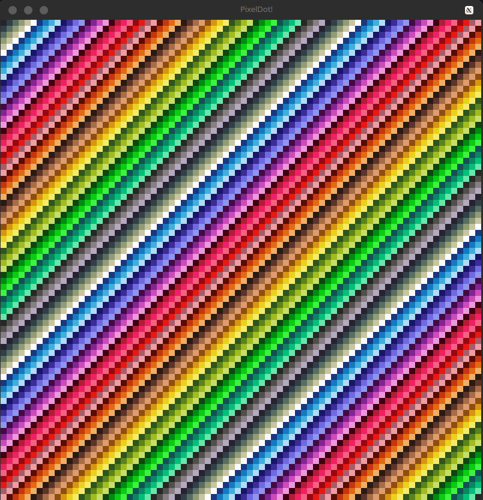

# PixelDot
PixelDot is a simple game framework written in C# utilising SFML.net to provide a fantasy console-esque environment for creating games with imposed limitations and is based around only using individual pixels as the base unit of graphics. This project is not intended to be used a game framework but a playground to experiment with.

## Creating applications
You create "Applications" which contain a create, update and end method where you can use a variety of methods provided by PixelDot.

To create an application, you must inherit from the `Application` class and use the `RunnableApplication` attribute.

## Running applications
After you create the application, you must provide four arguments to the application: `window width`, `window height`, `pixel scale` and `application class name`.

A simple script to compile and run the application can be found in `test-run.sh` (Linux/Mac OS X users) and `test-run.bat` (Windows users).

## Provided classes
- `Palette` - Predefined NES-inspired colour palette supported by PixelDot.
- `Logger` - Functionality to log information to the console and optional log files.
- `Input` - Keyboard and mouse input handling for PixelDot.
- `Core` - Core engine managing the window lifecycle, frame pacing, and batch pixel rendering.
- `Text` - Render text to the display

## Generate documentation

Run `docfx`.